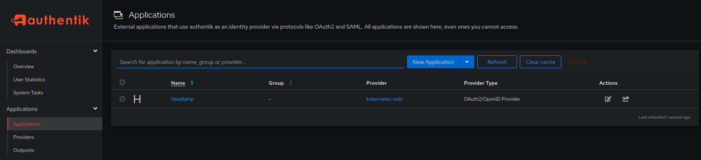
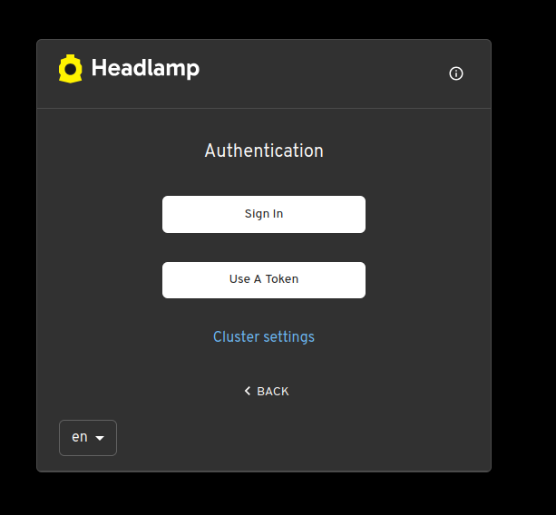

# Install Helm on `jumpbox` machine
```bash
curl -fsSL https://raw.githubusercontent.com/helm/helm/main/scripts/get-helm-3 | bash
helm repo update
```

# Taint master nodes

```bash
kubectl taint nodes k8s-master-1 node-role.kubernetes.io/control-plane=:NoSchedule
kubectl taint nodes k8s-master-2 node-role.kubernetes.io/control-plane=:NoSchedule
kubectl taint nodes k8s-master-3 node-role.kubernetes.io/control-plane=:NoSchedule
```

# Install CoreDNS

```bash
cat > coredns.yaml <<'EOF'
apiVersion: v1
kind: ServiceAccount
metadata:
  name: coredns
  namespace: kube-system
---
apiVersion: v1
kind: ConfigMap
metadata:
  name: coredns
  namespace: kube-system
data:
  Corefile: |
    .:53 {
        errors
        health
        ready
        kubernetes cluster.local 10.200.0.0/16 {
          pods insecure
          fallthrough in-addr.arpa ip6.arpa
        }
        prometheus :9153
        forward . 8.8.8.8 1.1.1.1
        cache 30
        loop
        reload
        loadbalance
    }
---
apiVersion: v1
kind: Service
metadata:
  name: kube-dns
  namespace: kube-system
spec:
  clusterIP: 10.0.0.10
  selector:
    k8s-app: kube-dns
  ports:
  - name: dns
    port: 53
    protocol: UDP
  - name: dns-tcp
    port: 53
    protocol: TCP
---
apiVersion: apps/v1
kind: Deployment
metadata:
  name: coredns
  namespace: kube-system
spec:
  replicas: 2
  selector:
    matchLabels:
      k8s-app: kube-dns
  template:
    metadata:
      labels:
        k8s-app: kube-dns
    spec:
      serviceAccountName: coredns
      containers:
      - name: coredns
        image: registry.k8s.io/coredns/coredns:v1.12.1
        args:
        - -conf
        - /etc/coredns/Corefile
        volumeMounts:
        - name: config
          mountPath: /etc/coredns
        ports:
        - containerPort: 53
          protocol: UDP
        - containerPort: 53
          protocol: TCP
      volumes:
      - name: config
        configMap:
          name: coredns
EOF
```

```bash
cat > coredns-rbac.yaml <<'EOF'
apiVersion: rbac.authorization.k8s.io/v1
kind: ClusterRole
metadata:
  name: system:coredns
rules:
- apiGroups: [""]
  resources:
  - endpoints
  - services
  - pods
  - namespaces
  verbs:
  - list
  - watch

- apiGroups:
  - discovery.k8s.io
  resources:
  - endpointslices
  verbs:
  - list
  - watch
---
apiVersion: rbac.authorization.k8s.io/v1
kind: ClusterRoleBinding
metadata:
  name: system:coredns
roleRef:
  apiGroup: rbac.authorization.k8s.io
  kind: ClusterRole
  name: system:coredns
subjects:
- kind: ServiceAccount
  name: coredns
  namespace: kube-system
EOF
```

# Create ClusterRoleBinding for kube-proxy

```bash
cat > kube-proxy-clusterrolebinding.yaml <<'EOF'
apiVersion: rbac.authorization.k8s.io/v1
kind: ClusterRoleBinding
metadata:
  name: system:kube-proxy
roleRef:
  apiGroup: rbac.authorization.k8s.io
  kind: ClusterRole
  name: system:node-proxier
subjects:
- kind: User
  name: system:kube-proxy
  apiGroup: rbac.authorization.k8s.io
EOF
```

# Apply yamls

```bash
kubectl apply -f kube-proxy-clusterrolebinding.yaml
kubectl apply -f coredns-rbac.yaml
kubectl apply -f coredns.yaml

kubectl get svc -n kube-system
kubectl get pods -n kube-system
```

```text
NAME       TYPE        CLUSTER-IP   EXTERNAL-IP   PORT(S)         AGE
kube-dns   ClusterIP   10.0.0.10    <none>        53/UDP,53/TCP   11s


NAME                       READY   STATUS              RESTARTS   AGE
coredns-784c699c6b-cfncj   1/1     Running             0          89s
coredns-784c699c6b-6f8rq   1/1     Running             0          89s

```

# Check rights

```bash
kubectl auth can-i list services --as=system:kube-proxy
kubectl auth can-i watch endpointslices --as=system:kube-proxy
kubectl auth can-i watch nodes --as=system:kube-proxy
```

# On worker nodes
```bash
for host in k8s-worker-1 k8s-worker-2 k8s-worker-3; do
  ssh root@${host} '
    systemctl restart kube-proxy
  '
done
```

# Install ingress-nginx

```bash
helm repo add ingress-nginx https://kubernetes.github.io/ingress-nginx
helm repo update

#helm install ingress-nginx ingress-nginx-*.tgz \
#  --namespace ingress-nginx \
#  --create-namespace

helm install ingress-nginx ingress-nginx/ingress-nginx \
  -n ingress-nginx \
  --create-namespace \
  --set controller.service.type=NodePort \
  --set controller.service.nodePorts.http=32080 \
  --set controller.service.nodePorts.https=32443
```

# Verify

```bash
kubectl get pods -n ingress-nginx
kubectl get svc -n ingress-nginx
```

```text
NAME                                        READY   STATUS    RESTARTS   AGE
ingress-nginx-controller-7558b45cf6-kbnsz   1/1     Running   0          17s

NAME                                 TYPE        CLUSTER-IP   EXTERNAL-IP   PORT(S)                      AGE
ingress-nginx-controller             NodePort    10.0.0.19    <none>        80:32080/TCP,443:32443/TCP   37s
ingress-nginx-controller-admission   ClusterIP   10.0.0.144   <none>        443/TCP                      37s

```


# Install Headlamp

```bash
kubectl apply -f https://raw.githubusercontent.com/kubernetes-sigs/headlamp/main/kubernetes-headlamp.yaml

kubectl get svc -n kube-system | grep "headlamp"
kubectl get po -n kube-system | grep "headlamp"
```

```text
NAME       TYPE        CLUSTER-IP   EXTERNAL-IP   PORT(S)   AGE
headlamp   ClusterIP   10.0.0.200   <none>        80/TCP    77s

NAME                      READY   STATUS    RESTARTS   AGE
headlamp-747b5f4d5-wsvhx   1/1     Running   0         56s
```

# Exposing Headlamp with an ingress server

```bash
cat > headlamp-ingress.yaml <<'EOF'
apiVersion: networking.k8s.io/v1
kind: Ingress
metadata:
  name: headlamp
  namespace: kube-system
spec:
  ingressClassName: nginx
  rules:
  - host: headlamp.kubernetes.local
    http:
      paths:
      - path: /
        pathType: Prefix
        backend:
          service:
            name: headlamp
            port:
              number: 80
EOF
```

```bash
kubectl apply -f headlamp-ingress.yaml
```

# Check Headlamp availability
```bash
curl http://headlamp.kubernetes.local/
```

Or open in browser `http://headlamp.kubernetes.local/`

# Initial test access to the Headlamp

Going with the manual from https://headlamp.dev/docs/latest/installation/in-cluster/#using-simple-yaml

Once Headlamp is up and running, be sure to enable access to it either by creating a service account or by setting up OIDC.

```bash
cat > headlamp-crb.yaml <<'EOF'
apiVersion: rbac.authorization.k8s.io/v1
kind: ClusterRoleBinding
metadata:
  name: headlamp-admin
roleRef:
  apiGroup: rbac.authorization.k8s.io
  kind: ClusterRole
  name: cluster-admin
subjects:
- kind: ServiceAccount
  name: headlamp-admin
  namespace: kube-system
EOF

cat > headlamp-sa.yaml <<'EOF'
apiVersion: v1
kind: ServiceAccount
metadata:
  name: headlamp-admin
  namespace: kube-system
EOF


kubectl apply -f headlamp-sa.yaml
kubectl apply -f headlamp-crb.yaml
kubectl create token headlamp-admin -n kube-system
```

# Authentik installation

Install local-path-provisioner

```bash
kubectl apply -f https://raw.githubusercontent.com/rancher/local-path-provisioner/master/deploy/local-path-storage.yaml
kubectl get pods -n local-path-storage
kubectl get storageclass
```

```text
local-path-provisioner-7fbdf596b7-npv9g   1/1     Running             0          16s

NAME         PROVISIONER             RECLAIMPOLICY   VOLUMEBINDINGMODE      ALLOWVOLUMEEXPANSION   AGE
local-path   rancher.io/local-path   Delete          WaitForFirstConsumer   false                  32s
```

```bash
kubectl patch storageclass local-path \
  -p '{"metadata":{"annotations":{"storageclass.kubernetes.io/is-default-class":"true"}}}'
```

Add helm repo and create namespace

```bash
helm repo add authentik https://charts.goauthentik.io
helm repo update
kubectl create namespace authentik
```

Create secret strings for our authentik-values.yaml

```bash
openssl rand -base64 48
openssl rand -base64 32
```

Put them in the file

```bash
cat > authentik-values.yaml <<'EOF'
authentik:
  secret_key: "base64-48-output"

  postgresql:
    password: "base64-32-output"
postgresql:
  enabled: true
  auth:
    password: "base64-32-output"
EOF
```

Install

```bash
helm upgrade --install authentik authentik/authentik \
  --namespace authentik \
  --create-namespace \
  -f authentik-values.yaml
```

```bash
kubectl -n authentik get pods
```

```text
NAME                                READY   STATUS    RESTARTS   AGE
authentik-postgresql-0              1/1     Running   0          11m
authentik-server-745f766f7d-rbz6v   1/1     Running   0          2m40s
authentik-worker-8fb45dd65-5plwz    1/1     Running   0          3m56s
```

# Install Authentik Ingress

```bash
cat > authentik-ingress.yaml <<'EOF'
apiVersion: networking.k8s.io/v1
kind: Ingress
metadata:
  name: authentik
  namespace: authentik
spec:
  ingressClassName: nginx
  rules:
    - host: authentik.kubernetes.local
      http:
        paths:
          - path: /
            pathType: Prefix
            backend:
              service:
                name: authentik-server
                port:
                  number: 80
EOF

kubectl apply -f authentik-ingress.yaml
kubectl -n authentik get ingress
```

```text
NAME        CLASS   HOSTS                        ADDRESS   PORTS   AGE
authentik   nginx   authentik.kubernetes.local             80      10s
```

Check ingress

```bash
curl -i \
  -H 'Host: authentik.kubernetes.local' \
  http://192.168.31.204:32080/
```

Open in browser `http://authentik.kubernetes.local`, it should redirect to `http://authentik.kubernetes.local/if/flow/initial-setup/`

Create your first admin and access to `http://authentik.kubernetes.local/if/admin/#/administration/overview`


# Setup Authentik as OIDC Identity Provider for Kubernetes, then setup Headlamp with OIDC.

All goes in UI

```text

Step 1. Create an app in Authentik

First stage of Configure the Application.

Fill like this:

Name: Headlamp
Slug: headlamp
Group: # Leave it empty
Policy engine mode: ANY — by default

Next.

Step 2. Select provider

Select OAuth2/OpenID Provider and press Next.

Step 3. Setup OIDC Provider

At Configure Provider setup these:

Name	kubernetes-oidc
Authorization flow	default-provider-authorization-implicit-consent or standart flow
Client type	Confidential
Client ID	Leave autogenerated ID
Client Secret	Save it, we will use it later with Headlamp
Signing Key	Standart key Authentik
Redirect URI	http://headlamp.kubernetes.local/oidc-callback


Next and go to Configure Bindings. Go to Review and Submit and create an app.


```

check OIDC discovery from jumpbox machine

```bash
curl -fsS \
  http://authentik.kubernetes.local/application/o/headlamp/.well-known/openid-configuration \
  | python3 -m json.tool
```


Enable OIDC in Headlamp

Create Secret for Client Secret

Put Client Secret from Authentik, not the Client ID

At jumpbox run:

```bash
read -rsp "Enter Authentik Client Secret: " OIDC_CLIENT_SECRET
echo

kubectl create secret generic headlamp-oidc \
  -n kube-system \
  --from-literal=HEADLAMP_CONFIG_OIDC_CLIENT_SECRET="$OIDC_CLIENT_SECRET" \
  --dry-run=client -o yaml | kubectl apply -f -

unset OIDC_CLIENT_SECRET
```

add settings for OIDC

Run:

```bash
kubectl set env deployment/headlamp -n kube-system \
  HEADLAMP_CONFIG_OIDC_CLIENT_ID='bEPrKPdVwNquWFE2x6JrSEXFSVy1ymcq2MOli1EZ' \
  HEADLAMP_CONFIG_OIDC_IDP_ISSUER_URL='http://authentik.kubernetes.local/application/o/headlamp/' \
  HEADLAMP_CONFIG_OIDC_SCOPES='profile,email'
```

Attach Secret as environment variable:

```bash
kubectl set env deployment/headlamp -n kube-system \
  --from=secret/headlamp-oidc
```

Wait for restart:

```bash
kubectl rollout status deployment/headlamp -n kube-system
```

Make sure the pod is running:

```bash
kubectl get pods -n kube-system | grep headlamp
```

Update CoreDNS and add authentik there

```bash
kubectl get configmap coredns -n kube-system -o yaml \
  > coredns-backup.yaml
```

```bash
kubectl apply -f - <<'EOF'
apiVersion: v1
kind: ConfigMap
metadata:
  name: coredns
  namespace: kube-system
data:
  Corefile: |
    .:53 {
        errors
        health
        ready
        hosts {
            10.0.0.19 authentik.kubernetes.local headlamp.kubernetes.local
            fallthrough
        }
        kubernetes cluster.local 10.200.0.0/16 {
          pods insecure
          fallthrough in-addr.arpa ip6.arpa
        }
        prometheus :9153
        forward . 8.8.8.8 1.1.1.1
        cache 30
        loop
        reload
        loadbalance
    }
EOF
```

run test
```bash
root@jumpbox:~# kubectl run dns-test \
  -n kube-system \
  --rm -it \
  --restart=Never \
  --image=busybox:1.36 \
  -- nslookup authentik.kubernetes.local
```

```text
Server:		10.0.0.10
Address:	10.0.0.10:53

Name:	authentik.kubernetes.local
Address: 10.0.0.19


pod "dns-test" deleted
```

Create CA and TLS-certificate

Setup files

```bash
mkdir -p /root/authentik-oidc-tls
cd /root/authentik-oidc-tls
```
Create local CA:

```bash
openssl req -x509 -newkey rsa:4096 -nodes \
-keyout ca.key \
-out ca.crt \
-days 3650 \
-subj "/CN=Kubernetes Local OIDC CA"
```

Create key and certificate request for Authentik:

```bash
openssl req -new -newkey rsa:2048 -nodes \
-keyout authentik.key \
-out authentik.csr \
-subj "/CN=authentik.kubernetes.local"
```
add SAN:

```bash
cat > authentik.ext <<'EOF'
subjectAltName = DNS:authentik.kubernetes.local
extendedKeyUsage = serverAuth
keyUsage = digitalSignature, keyEncipherment
EOF
```
Sign the certificate using the created CA:

```bash
openssl x509 -req \
-in authentik.csr \
-CA ca.crt \
-CAkey ca.key \
-CAcreateserial \
-out authentik.crt \
-days 825 \
-sha256 \
-extfile authentik.ext
```
Check certificate:

```bash
openssl verify -CAfile ca.crt authentik.crt
```

Expected result:

```text
authentik.crt: OK
```

Attach the certificate to the Ingress

Create a TLS Secret in the authentik namespace:

```bash
kubectl create secret tls authentik-oidc-tls \
-n authentik \
--cert=/root/authentik-oidc-tls/authentik.crt \
--key=/root/authentik-oidc-tls/authentik.key
```
Enable TLS in the existing Ingress:

```bash
kubectl patch ingress authentik -n authentik \
--type=merge \
-p '{"spec":{"tls":[{"hosts":["authentik.kubernetes.local"],"secretName":"authentik-oidc-tls"}]}}'
```

Check result:

```bash
kubectl get ingress authentik -n authentik
```

In PORTS should be 443.

Check OIDC issuer for HTTPS

Run:

```bash
curl --cacert /root/authentik-oidc-tls/ca.crt -fsS \
https://authentik.kubernetes.local/application/o/headlamp/.well-known/openid-configuration \
| python3 -c 'import json,sys; print(json.load(sys.stdin)["issuer"])'
```

Expected result:
```text
https://authentik.kubernetes.local/application/o/headlamp/
```

Setup CA on the master nodes

At jumpbox run:

```bash
for node in k8s-master-1 k8s-master-2 k8s-master-3; do
echo "===== $node ====="

scp /root/authentik-oidc-tls/ca.crt \
root@"$node":/tmp/authentik-oidc-ca.crt

ssh root@"$node" \
'install -o root -g root -m 0644 /tmp/authentik-oidc-ca.crt /var/lib/kubernetes/authentik-oidc-ca.crt && rm /tmp/authentik-oidc-ca.crt'
done
```

Then, check whether the Authentik name resolves on each master node:

```bash
for node in k8s-master-1 k8s-master-2 k8s-master-3; do
echo "===== $node ====="
ssh root@"$node" \
'getent hosts authentik.kubernetes.local'
done
```

Now, before changing the API server configuration, you need to verify HTTPS and certificate trust from each master node:

```bash
for node in k8s-master-1 k8s-master-2 k8s-master-3; do
  echo "===== $node ====="
  ssh root@"$node" '
    curl --cacert /var/lib/kubernetes/authentik-oidc-ca.crt \
      -fsS https://authentik.kubernetes.local/application/o/headlamp/.well-known/openid-configuration \
      | python3 -c '\''import json,sys; print(json.load(sys.stdin)["issuer"])'\''
  '
done
```

Now we should setup OIDC in kube-apiserver:

```bash
for node in k8s-master-1 k8s-master-2 k8s-master-3; do
echo "===== $node ====="
ssh root@"$node" '
cp -a /etc/systemd/system/kube-apiserver.service \
/etc/systemd/system/kube-apiserver.service.bak-oidc
grep -E -- "--(authorization-mode|oidc-|advertise-address)" \
/etc/systemd/system/kube-apiserver.service
'
done
```

Let's add OIDC to k8s-master-1

Add these to /etc/systemd/system/kube-apiserver.service:
```text
--oidc-issuer-url=https://authentik.kubernetes.local/application/o/headlamp/ \
--oidc-client-id=<YOUR_ID> \
--oidc-username-claim=preferred_username \
--oidc-groups-claim=groups \
--oidc-ca-file=/var/lib/kubernetes/authentik-oidc-ca.crt \
```

```bash
ssh root@k8s-master-1 "python3 - <<'PY'
from pathlib import Path

p = Path('/etc/systemd/system/kube-apiserver.service')
s = p.read_text()

marker = '  --authorization-mode=Node,RBAC \\\\'
oidc = '''  --authorization-mode=Node,RBAC \\\\
  --oidc-issuer-url=https://authentik.kubernetes.local/application/o/headlamp/ \\\\
  --oidc-client-id=bEPrKPdVwNquWFE2x6JrSEXFSVy1ymcq2MOli1EZ \\\\
  --oidc-username-claim=preferred_username \\\\
  --oidc-groups-claim=groups \\\\
  --oidc-ca-file=/var/lib/kubernetes/authentik-oidc-ca.crt \\\\'''

if '--oidc-issuer-url=' in s:
    raise SystemExit('OIDC parameters already exist; no changes made.')
if s.count(marker) != 1:
    raise SystemExit('Could not find a unique authorization-mode line; no changes made.')

p.write_text(s.replace(marker, oidc))
print('OIDC parameters added.')
PY"
```

```bash
ssh root@k8s-master-1 \
  'grep -E -- "--(authorization-mode|oidc-)" /etc/systemd/system/kube-apiserver.service'
```

Do checks before k8s-master-1 restart:

```bash
ssh root@k8s-master-1 'systemd-analyze verify /etc/systemd/system/kube-apiserver.service'
```

Then restart and check after

```bash
ssh root@k8s-master-1 'systemctl daemon-reload && systemctl restart kube-apiserver'

ssh root@k8s-master-1 'systemctl is-active kube-apiserver && systemctl --no-pager --full status kube-apiserver'

kubectl --request-timeout=5s get nodes
```

Setup k8s-master-2 and k8s-master-3:

```bash
for node in k8s-master-2 k8s-master-3; do
  echo "===== $node ====="
  ssh root@"$node" "python3 - <<'PY'
from pathlib import Path

p = Path('/etc/systemd/system/kube-apiserver.service')
s = p.read_text()
marker = '  --authorization-mode=Node,RBAC \\\\'
oidc = '''  --authorization-mode=Node,RBAC \\\\
  --oidc-issuer-url=https://authentik.kubernetes.local/application/o/headlamp/ \\\\
  --oidc-client-id=bEPrKPdVwNquWFE2x6JrSEXFSVy1ymcq2MOli1EZ \\\\
  --oidc-username-claim=preferred_username \\\\
  --oidc-groups-claim=groups \\\\
  --oidc-ca-file=/var/lib/kubernetes/authentik-oidc-ca.crt \\\\'''

if '--oidc-issuer-url=' in s:
    print('OIDC already configured; skipping.')
elif s.count(marker) != 1:
    raise SystemExit('Authorization line not found uniquely; no changes made.')
else:
    p.write_text(s.replace(marker, oidc))
    print('OIDC parameters added.')
PY"
done
```

Do checks:

```bash
for node in k8s-master-2 k8s-master-3; do
  echo "===== $node ====="
  ssh root@"$node" \
    'grep -E -- "--(authorization-mode|oidc-)" /etc/systemd/system/kube-apiserver.service'
done
```

Restart k8s-master-2 and k8s-master-3:

```bash
ssh root@k8s-master-2 \
  'systemctl daemon-reload && systemctl restart kube-apiserver'

ssh root@k8s-master-2 \
  'systemctl is-active kube-apiserver'
  
kubectl --request-timeout=5s get nodes  
```

```bash
ssh root@k8s-master-3 \
  'systemctl daemon-reload && systemctl restart kube-apiserver'

ssh root@k8s-master-3 \
  'systemctl is-active kube-apiserver'
  
kubectl --request-timeout=5s get nodes
```


Create ConfigMap for CA in Headlamp:

```bash
kubectl -n kube-system create configmap authentik-oidc-ca \
  --from-file=ca.crt=/root/authentik-oidc-tls/ca.crt \
  --dry-run=client -o yaml | kubectl apply -f -
  
kubectl -n kube-system get configmap authentik-oidc-ca
```

```text
NAME                DATA   AGE
authentik-oidc-ca   1      24s
```

Add certificate to Deployment

```bash
cat > /tmp/headlamp-ca-patch.yaml <<'EOF'
spec:
  template:
    spec:
      volumes:
        - name: authentik-oidc-ca
          configMap:
            name: authentik-oidc-ca
      containers:
        - name: headlamp
          volumeMounts:
            - name: authentik-oidc-ca
              mountPath: /etc/headlamp/oidc-ca
              readOnly: true
EOF

kubectl -n kube-system patch deployment headlamp \
  --type=strategic \
  --patch-file=/tmp/headlamp-ca-patch.yaml
  
kubectl -n kube-system rollout status deployment/headlamp

kubectl -n kube-system exec deployment/headlamp -- \
  ls -l /etc/headlamp/oidc-ca/ca.crt
```

Setup Headlamp to HTTPS:

```bash
kubectl -n kube-system patch deployment headlamp --type=strategic \
  -p '{"spec":{"template":{"spec":{"containers":[{"name":"headlamp","args":["-in-cluster","-plugins-dir=/headlamp/plugins","-oidc-ca-file=/etc/headlamp/oidc-ca/ca.crt"]}]}}}}'

kubectl -n kube-system set env deployment/headlamp \
  HEADLAMP_CONFIG_OIDC_IDP_ISSUER_URL=https://authentik.kubernetes.local/application/o/headlamp/
  
kubectl -n kube-system rollout status deployment/headlamp

kubectl -n kube-system get deployment headlamp \
  -o jsonpath='{.spec.template.spec.containers[0].args}{"\n"}{range .spec.template.spec.containers[0].env[*]}{.name}{"="}{.value}{"\n"}{end}'

```

Add permissions to our lab account:

```bash
kubectl create clusterrolebinding authentik-akadmin-oidc-admin \
  --clusterrole=cluster-admin \
  --user='https://authentik.kubernetes.local/application/o/headlamp/#akadmin'
```

Check enter

Open in browser:

https://headlamp.kubernetes.local/

An option to log in via OIDC should be available. When you click the login button, Headlamp should redirect you to Authentik. Once authorized, the browser will return to /oidc-callback.

